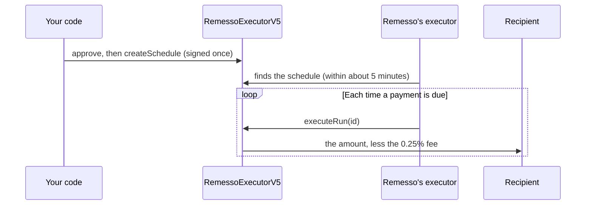

A schedule is a payment the payer signs once: a fixed amount, to a fixed address, on a fixed cadence. Remesso's executor sends each payment when it is due. This page covers creating a schedule with the SDK, checking on it, and managing it afterwards.

After signing, nothing can change the recipient, the amount or the cadence: not Remesso, not the contract's owner, not the payer. The payer can pause, resume or cancel. Cancelling is the only edit.

## Before you start

You need:

- a client with an account that holds the token you pay in. See [Installation](../installation.md).
- gas for two transactions, an approval and the schedule itself. CELO works for every token. With no CELO, USDT, USDC, USDm and USA₮ can pay their own gas. See [Fees, limits and gas](./fees-and-gas.md).
- at least the executor's minimum per payment: the equivalent of 1 US dollar, such as 1 USDT or 1,500 wARS.

## Create a schedule

`schedules.create` approves the contract for the schedule's total, creates the schedule, and returns its id. This program pays 5 USDT a month, twelve times:

```ts title="pay-monthly.ts"
import { createRemesso, formatAmount } from "remesso-sdk";
import { privateKeyToAccount } from "viem/accounts";

const payer = createRemesso({
  account: privateKeyToAccount(process.env.PAYER_KEY as `0x${string}`),
});

const s = await payer.schedules.create({
  to: process.env.RECIPIENT!,
  amount: "5",
  token: "USDT",
  every: "month",
  runs: 12,
});

console.log(`schedule ${s.id}: ${formatAmount(s.recipientGets, s.token)} arrives each month`);
console.log(`approval ${s.approveHash}, schedule ${s.hash}`);
for (const w of s.warnings) console.warn(w);
```

Two transactions go out, in order:

1. **An approval.** The SDK adds this schedule's total (here 60 USDT) to the approval you have already given the contract. It never replaces it, because another schedule may rely on it. Pass `approve: false` if you manage approvals yourself.
2. **The schedule.** The SDK reads its id from the transaction's own `ScheduleCreated` log.

Before either is signed, the SDK checks everything the contract or the executor would refuse. See [What the SDK refuses before signing](#what-the-sdk-refuses-before-signing).

### Options

| Option | Required | What it is |
|---|---|---|
| `to` | Yes, unless `request` gives it | The recipient's address. |
| `amount` | One of `amount` or `receive` | What leaves your wallet each payment, as a decimal string: `"1.50"`. |
| `receive` | One of `amount` or `receive` | What the recipient receives each payment, after the fee. The SDK works out what to send. |
| `token` | No | A symbol or an address. Default `USDT`, or the request's token. |
| `every` | No | `"week"`, `"fortnight"`, `"month"`, `"quarter"`, or a number of seconds, at least 3,600. Default `"week"`, or the request's cadence. |
| `runs` | Yes, unless `request` gives it | How many payments. |
| `firstRunAt` | No | A `Date` for the first payment. Default: now. |
| `trigger` | No | Who may bring a payment forward: `"remesso"` or an address. Default: nobody. |
| `triggers` | No | How many early sends the trigger may make. Default: one per payment. |
| `request` | No | The id of a payment request this schedule answers. Its terms fill whatever you leave out. |
| `approve` | No | `false` to skip the approval. Default: approve this schedule's total on top of what is already approved. |

## Send an amount, or make an amount arrive

The 0.25% fee comes out of each payment. Choose which side of it you fix:

```ts
// 1 USDT leaves your wallet. The recipient receives 0.9975 USDT.
await payer.schedules.create({ to: "0xRecipient", amount: "1", token: "USDT", every: "week", runs: 4 });

// 1 USDT arrives. Your wallet sends 1.002507 USDT.
await payer.schedules.create({ to: "0xRecipient", receive: "1", token: "USDT", every: "week", runs: 4 });
```

Use `receive` when the recipient is owed an exact amount, such as an invoice. The per-payment limits apply to what leaves your wallet in both cases. [Fees, limits and gas](./fees-and-gas.md) shows the arithmetic.

## Choose the cadence and the first payment

`every` takes a cadence name or a number of seconds:

| `every` | Interval |
|---|---|
| `"week"` | 7 days |
| `"fortnight"` | 14 days |
| `"month"` | 30 days |
| `"quarter"` | 90 days |
| a number | that many seconds, at least 3,600 |

`"weekly"`, `"monthly"` and the other `-ly` forms are accepted too. A month is always 30 days, as in the Remesso app.

```ts
// Every three days, ten times.
await payer.schedules.create({ to: "0xRecipient", amount: "20", every: 3 * 86_400, runs: 10 });

// Monthly in USDC, the first payment a week from now.
await payer.schedules.create({
  to: "0xRecipient",
  amount: "250",
  token: "USDC",
  every: "month",
  runs: 6,
  firstRunAt: new Date(Date.now() + 7 * 86_400_000),
});
```

A schedule lasts at most a year. The SDK sets its expiry to one interval and an hour after the last payment's slot, so `runs` payments must fit within 365 days: 12 monthly payments or 52 weekly ones fit, 13 monthly ones don't. For longer arrangements, create a new schedule before the old one ends.

`firstRunAt` can't be in the past.

## What you get back

`create` returns a `CreatedSchedule`:

| Field | What it is |
|---|---|
| `id` | The schedule's id on the contract, a `bigint`. |
| `hash` | The `createSchedule` transaction. |
| `approveHash` | The approval transaction, or `null` with `approve: false`. |
| `to`, `token` | The recipient, checksummed, and the token's symbol. |
| `amountIn` | What leaves your wallet each payment, in base units. |
| `recipientGets` | What the recipient receives each payment, in base units, after the fee. |
| `feeBps` | The commission this schedule pinned, in basis points (25 is 0.25%). |
| `runs`, `intervalSeconds` | How many payments, and how far apart. |
| `firstRunAt`, `expiresAt` | When the first payment is due, and when the schedule ends. |
| `request` | With `request`: how the request took the answer (`status` and `signed`), or `error`. |
| `warnings` | Things to fix that didn't stop the schedule, such as a balance below one payment. |

Check `warnings`. A schedule whose payer can't cover a payment is valid, and each payment fails until the wallet is funded.

## When the first payment goes out

The first payment is due at `firstRunAt`, which is now unless you set it. Remesso's executor sends due payments every minute. It learns about schedules created outside the Remesso app through a sync that reads the contract every five minutes. So the sync finds a new schedule within about five minutes, and its first payment goes out within a minute of that.



After that:

- **Each payment is due one interval after the previous one actually went out.** The cadence is measured from the payment, not from the original timetable.
- **Missed payments aren't caught up.** If a payment can't go, because the wallet is short, the approval is too low or the schedule is paused, it stays due and is retried. When it does go, the next one is due an interval later. A payer is never charged for two periods at once.
- **The schedule stops** after `runs` payments, at its expiry, or when it is cancelled.

To know when a payment arrived, watch [payment events](./payment-events.md) or receive [webhooks](./webhooks.md).

## Let a payment be sent early

A trigger may bring one payment forward, ahead of its date. Grant it when you create the schedule:

```ts
const s = await payer.schedules.create({
  to: "0xRecipient",
  amount: "10",
  every: "month",
  runs: 12,
  trigger: "remesso", // Remesso's executor, whichever key it is at the time
  triggers: 3, // at most three early sends
});

await payer.schedules.setTrigger(s.id, "remesso", 1); // one early send left
await payer.schedules.setTrigger(s.id, null); // nobody can send early any more
```

`trigger` is `"remesso"` or an address:

- `"remesso"` stores Remesso's sentinel address, `0x0000000000000000000000000000000000000001`. It means whichever key is Remesso's executor at the time, so a key rotation moves the grant. Anyone can then pay 0.01 USDC, USDT or USA₮ over x402 to `trigger-run` and have Remesso send one payment early. See the [HTTP API](../reference/http-api.md).
- An address, such as your own agent's, lets that key call `runNow` on the contract itself and pay the gas.

An early send can't change the recipient or the amount, and it doesn't add a payment. It uses up the next one: if a payment is due next week and is sent today, the one after keeps its own date. Early sends are at most one a minute, never past the expiry, and stop when the count runs out. Sending a payment that is already due uses no count.

`setTrigger` takes the count as its third argument, and it defaults to 0, so pass a count whenever you grant a trigger.

A schedule created through the SDK is found by Remesso's sync within about five minutes. Until then, only a trigger can move it. `trigger: "remesso"` lets a first payment go out without waiting for the sync.

## Answer a payment request

When someone has sent you a [payment request](./payment-requests.md), create the schedule from it. Its terms fill everything you leave out, and the SDK reports the schedule against the request:

```ts
const s = await payer.schedules.create({ request: requestId });
if (s.request && "status" in s.request) console.log("the request reads", s.request.status);
else console.log("created, but not reported against the request:", s.request?.error);
```

The request's amount is what the recipient receives, so the SDK sends the amount plus the fee. The SDK refuses the request if it was sent to a different wallet, if it is no longer pending, or if you pass a `to` it didn't ask for. If reporting fails after the schedule is created, `create` still returns the schedule, with the reason in `s.request.error`.

## Read a schedule back

```ts
import { formatAmount } from "remesso-sdk";

const s = await payer.schedules.get(scheduleId);
console.log(`${s.runsExecuted} of ${s.maxRuns} paid, next due ${s.nextRunAt.toISOString()}`);
console.log(`${formatAmount(s.recipientGets, s.token)} arrives each time`);

const { due, funded, approved } = await payer.schedules.status(scheduleId);
if (due && !funded) console.warn("a payment is due and the wallet holds less than one payment");
if (!approved) console.warn("the approval is below one payment: approve the contract again");

const ids = await payer.schedules.list(); // every schedule this wallet created
```

- **`get(id)`** returns the schedule as the contract stores it: `sender`, `to`, `token`, `amountIn`, `recipientGets`, `feeBps`, `intervalSeconds`, `maxRuns`, `runsExecuted`, `nextRunAt`, `lastRunAt`, `expiresAt`, `active`, `cancelled`, `trigger` and `triggersLeft`. Right after a schedule is created, a node can still answer from an earlier block, so `get` keeps asking for a few seconds. An id that doesn't exist throws [`not_found`](../reference/errors.md#not_found).
- **`status(id)`** asks the contract whether a payment can go now. `due` means a payment is due and the schedule is active, unexpired and not finished. `funded` means the payer's balance covers one payment, and `approved` means the approval does.
- **`list(sender?)`** returns the ids of every schedule a sender has created, by default this account's. A read-only client can pass any address.

## Pause, resume or cancel

Only the wallet that created a schedule can change it.

```ts
await payer.schedules.setActive(scheduleId, false); // pause
await payer.schedules.setActive(scheduleId, true); // resume
await payer.schedules.cancel(scheduleId); // for good
```

- **Pausing** stops payments until you resume. Payments that fall due while it is paused aren't caught up: after you resume, the due payment goes out and the cadence restarts from it.
- **Cancelling** is permanent. A cancelled schedule can't be resumed. Create a new one instead.
- **The approval stays** after a cancel. Lower it yourself if nothing else needs it. Revoking the token approval also stops every future payment from that token, which is the backstop if you can't reach the contract.

Each of these is a transaction. It pays gas in CELO, or in the schedule's token if you hold no CELO and the token can pay gas.

## What the SDK refuses before signing

Each refusal is a [`RemessoError`](../reference/errors.md) with a `code`, thrown before anything is signed:

| Situation | Code |
|---|---|
| `to` is missing or isn't an address | [`invalid`](../reference/errors.md#invalid) |
| `to` is your own wallet: a schedule paying itself only loses the fee | [`invalid`](../reference/errors.md#invalid) |
| Both `amount` and `receive`, or neither | [`invalid`](../reference/errors.md#invalid) |
| `runs` is missing or not a whole number | [`invalid`](../reference/errors.md#invalid) |
| `every` is under 3,600 seconds, or not a cadence name | [`invalid`](../reference/errors.md#invalid) |
| `firstRunAt` is in the past | [`invalid`](../reference/errors.md#invalid) |
| The token isn't one Remesso knows | [`invalid`](../reference/errors.md#invalid) |
| The contract doesn't take the token for new schedules | [`refused`](../reference/errors.md#refused) |
| The amount is outside the executor's per-payment range | [`refused`](../reference/errors.md#refused) |
| The payments don't fit in a year | [`refused`](../reference/errors.md#refused) |
| The request was sent to another wallet, isn't pending, or asks for another `to` | [`refused`](../reference/errors.md#refused) |
| The RPC isn't Celo mainnet | [`wrong_chain`](../reference/errors.md#wrong_chain) |
| The client has no account | [`no_account`](../reference/errors.md#no_account) |
| Neither CELO nor the token can pay the gas | [`no_gas`](../reference/errors.md#no_gas) |

The SDK also simulates each transaction first, and a refusal from the contract arrives as `refused` with the contract's reason in words. A transaction that is mined and then reverts throws [`reverted`](../reference/errors.md#reverted): nothing moved.

The per-payment range matters most. A schedule outside it is valid on-chain and would never run, because the executor won't send it:

```ts
import { RemessoError } from "remesso-sdk";

try {
  await payer.schedules.create({ to: "0xRecipient", amount: "0.50", token: "USDT", every: "week", runs: 4 });
} catch (e) {
  if (e instanceof RemessoError && e.code === "refused") console.error(e.message); // under the 1 USDT minimum
  else throw e;
}
```

## Next steps

- [Payment events](./payment-events.md) and [webhooks](./webhooks.md): know when each payment arrives.
- [Payment requests](./payment-requests.md): let the recipient ask for the schedule.
- [Fees, limits and gas](./fees-and-gas.md): what each payment costs, and every token's range.
