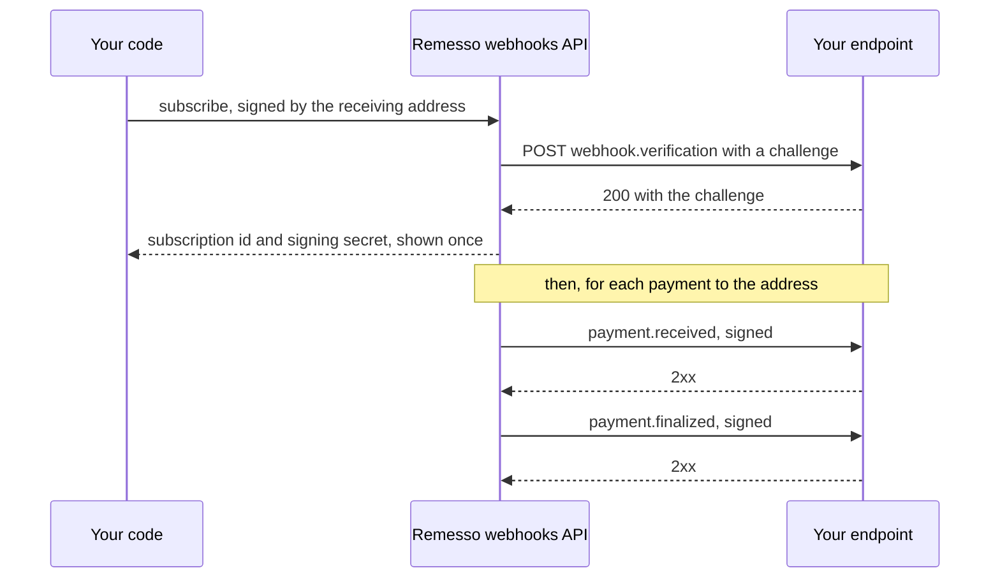

This guide shows how to receive a signed message at your server each time an address is paid, and how to run, verify and manage that endpoint.

## How it works

A webhook subscription ties a receiving address to an HTTPS endpoint. From then on, every schedule payment and every agent payment to that address is posted to the endpoint, signed the [Standard Webhooks](https://www.standardwebhooks.com/) way.

Only the address can manage its subscriptions. The SDK signs each request with the client's account (an EIP-712 signature), so nobody else can point your payments at their server or fill your subscription slots. Before anything is delivered, Remesso posts a challenge to the endpoint, and the endpoint must echo it.



Each payment produces up to three messages:

- `payment.received` as soon as the indexer sees the payment, with `final: false`;
- `payment.finalized` once Celo's finalized block passes it, usually 25 to 30 minutes later;
- `payment.removed` if a reorg undoes a payment you were already told about.

The exact format is in [webhook payloads](../reference/webhook-payloads.md).

## Run a handler

`webhookHandler` returns a fetch-style function, `(Request) => Promise<Response>`. It answers the challenge, verifies every delivery's signature and calls `onPayment` with the parsed message.

```ts title="receiver.ts"
import { createServer } from "node:http";
import { createRemesso, formatAmount, webhookHandler } from "remesso-sdk";
import { toNodeListener } from "remesso-sdk/node";
import { privateKeyToAccount } from "viem/accounts";

const receiver = createRemesso({
  account: privateKeyToAccount(process.env.RECEIVER_KEY as `0x${string}`),
});

// The secret exists only once the endpoint has answered the challenge, so the
// handler reads it when each delivery arrives.
let secret: string | undefined = process.env.WEBHOOK_SECRET;

const handler = webhookHandler({
  recipient: receiver.address,
  secret: () => secret,
  onPayment: async (m) => {
    console.log(m.type, formatAmount(m.data.amount, m.data.token), m.data.final ? "final" : "not final yet", m.data.txHash);
  },
});

const server = createServer(toNodeListener(handler));
await new Promise<void>((done) => server.listen(8787, done));
```

The handler answers:

| Request | Answer |
|---|---|
| A challenge for an address in `recipient` | `200` with the challenge |
| A challenge for any other address | `403`: a stranger can't point their deliveries at you |
| A delivery while there is no secret yet | `503`: Remesso retries |
| A delivery whose signature doesn't verify | `401` |
| A body that isn't a payment message | `400` |
| A verified delivery, and `onPayment` returns | `200` |
| A verified delivery, and `onPayment` throws | `500`: Remesso retries with the same `webhook-id` |

`recipient` takes one address or a list, if one endpoint receives for several. `secret` takes a string, a list (during a [rotation](#rotate-the-secret)), or a function that returns either, read on every delivery.

Throw from `onPayment` when you couldn't record the payment, for example because your database is down. Remesso then retries, so nothing is lost.

## Subscribe

Start the handler first: subscribing makes Remesso post the challenge to it straight away. Then subscribe from the receiving address:

```ts
let secret: string | undefined;

const sub = await receiver.webhooks.subscribe({ url: "https://example.com/remesso" });
secret = sub.secret; // shown once
console.log(sub.subscription, sub.state, "for", sub.recipient);
```

- The URL must be HTTPS, with no credentials and no fragment, at most 512 characters.
- `subscribe` returns `{ ok, subscription, recipient, url, state, secret }`. The secret is returned only this once: store it where your server can read it after a restart, such as a secret manager or an environment variable.
- A new subscription starts from now. It isn't sent the address's earlier payments; read those with [payment events](./payment-events.md).
- An address can hold 5 subscriptions. A sixth is refused until you revoke one.
- Subscribing a URL that is already subscribed for the address fails with [`conflict`](../reference/errors.md#conflict): rotate its secret, or revoke it and subscribe again.

If the endpoint doesn't echo the challenge, `subscribe` fails with `invalid` and says why, for example `the endpoint answered 404`. Nothing is kept, so fix the endpoint and subscribe again.

:::tip
For a quick test without a server on the internet, a Cloudflare quick tunnel gives your local port a public HTTPS address: `cloudflared tunnel --url http://localhost:8787`. It gets a new URL each time it starts, so revoke the old subscription when you're done.
:::

## Run it on other runtimes

The handler is a standard fetch handler, so it runs anywhere `Request` and `Response` exist.

**Deno:**

```ts
import { webhookHandler } from "remesso-sdk";

const handler = webhookHandler({
  recipient: Deno.env.get("RECEIVER_ADDRESS")!,
  secret: Deno.env.get("WEBHOOK_SECRET"),
  onPayment: (m) => console.log(m.type, m.data.txHash),
});

Deno.serve({ port: 8787 }, handler);
```

**Cloudflare Workers:**

```ts
import { webhookHandler } from "remesso-sdk";

export default {
  async fetch(req: Request, env: { RECEIVER_ADDRESS: string; WEBHOOK_SECRET: string }): Promise<Response> {
    const handler = webhookHandler({
      recipient: env.RECEIVER_ADDRESS,
      secret: env.WEBHOOK_SECRET,
      onPayment: (m) => console.log(m.type, m.data.txHash),
    });
    return await handler(req);
  },
};
```

**A Next.js route handler**, such as `app/api/remesso/route.ts`:

```ts
import { webhookHandler } from "remesso-sdk";

const handler = webhookHandler({
  recipient: process.env.RECEIVER_ADDRESS!,
  secret: process.env.WEBHOOK_SECRET,
  onPayment: async (m) => {
    // record the payment
    console.log(m.type, m.data.txHash);
  },
});

export async function POST(req: Request): Promise<Response> {
  return await handler(req);
}
```

**Bun** serves it as it is: `Bun.serve({ port: 8787, fetch: handler })`.

**Express** takes it through `toNodeListener`: `app.post("/remesso", toNodeListener(handler))`. Register that route before any JSON body parser such as `express.json()`. The signature covers the raw body, and a parser that has already consumed it leaves nothing to verify.

## Deduplicate deliveries

A delivery can arrive more than once, for example when your server handled it but its answer was lost. Every attempt at one delivery carries the same `webhook-id`, which the handler passes on as `m.id`. Record the ids you have processed and skip repeats:

```ts
import { webhookHandler } from "remesso-sdk";

const seen = new Set<string>(); // use your database in production

const handler = webhookHandler({
  recipient: receiver.address,
  secret: process.env.WEBHOOK_SECRET,
  onPayment: async (m) => {
    if (seen.has(m.id)) return;
    // ... record the payment ...
    seen.add(m.id);
  },
});
```

`payment.received` and `payment.finalized` for the same payment are two deliveries with two ids. To track the payment itself, key your records on `txHash` and `logIndex`, and update them as `final` and `removed` change.

## Retries

A delivery succeeds when your endpoint answers with a 2xx status within 10 seconds. Anything else is retried, with the same `webhook-id`, after 1 minute, 5 minutes, 30 minutes, 2 hours and 6 hours, then every 6 hours, for 24 hours from the first attempt. After that the delivery is held as failed until you [replay](#replay-failed-deliveries) it.

Each attempt is signed again with a fresh timestamp, and the signature is valid for 5 minutes, so keep your server's clock accurate.

## Verify a delivery yourself

If you don't use `webhookHandler`, verify each delivery against the raw body before trusting it. `parseWebhook` verifies and parses in one step, and throws a `RemessoError` when the signature doesn't verify (`refused`) or the body isn't a payment message (`invalid`):

```ts
import { parseWebhook, RemessoError } from "remesso-sdk";

export async function handle(req: Request): Promise<Response> {
  const raw = await req.text(); // the exact bytes that were signed
  try {
    const m = await parseWebhook(raw, req.headers, process.env.WEBHOOK_SECRET!);
    console.log(m.id, m.type, m.data.amount);
    return new Response("ok");
  } catch (e) {
    const status = e instanceof RemessoError && e.code === "invalid" ? 400 : 401;
    return new Response("refused", { status });
  }
}
```

`verifyWebhook(raw, headers, secrets)` answers only `true` or `false`. Both take one secret or a list. Your endpoint must still answer the challenge when you subscribe: reply `200` with the challenge, as the whole body or as `{"challenge": "..."}`.

## Rotate the secret

`rotate` issues a new signing secret. The old one keeps signing alongside it for a day, so you can deploy the new secret without missing a delivery.

```ts
const r = await receiver.webhooks.rotate({ url: "https://example.com/remesso" });
console.log("new secret:", r.secret, "old one valid until", r.previousSecretValidUntil);
```

Until `previousSecretValidUntil`, every delivery carries a signature from each secret, so a server holding either one verifies. Rotate when a secret may have leaked, or when you have lost it.

## Revoke a subscription

```ts
await receiver.webhooks.revoke({ url: "https://example.com/remesso" });
```

Deliveries to that URL stop, and the slot frees up for another subscription.

## Replay failed deliveries

If your endpoint was down for longer than the retry window, `replay` queues its failed deliveries again. `days` reaches back 1 to 7 days, 1 by default.

```ts
const { requeued } = await receiver.webhooks.replay({ url: "https://example.com/remesso", days: 3 });
console.log(requeued, "deliveries queued again");
```

Replayed deliveries keep their original `webhook-id`, so your deduplication still applies.

## Manage webhooks for another address

`subscribe`, `rotate`, `revoke` and `replay` act for the client's own address by default. Each also takes `recipient`, for a smart account you control: the client's account signs, and Remesso checks that signature against `recipient`, which a smart account accepts through ERC-1271. For any other address the signature doesn't match, and the request is refused.

Managing webhooks needs an account that can sign. On a read-only client these calls fail with [`no_account`](../reference/errors.md#no_account). The same API is available over HTTP: see [`webhooks` in the HTTP API](../reference/http-api.md#webhooks).
