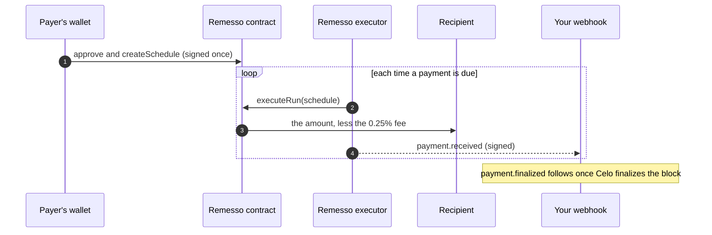

`remesso-sdk` is a TypeScript foundation for agent-to-agent remittances on Celo. Developers can build agents that request payments, send stablecoins from their own wallets or delegated policies, and verify settlement before delivering a service. It also supports recurring payments and signed notifications.

Start with [Build an agent-to-agent app](./guides/agent-to-agent.md) for the complete buyer/seller flow. Its new wallet-send, identity-aware payment and receipt-verification APIs are unreleased source changes; the published package remains 0.2.0 until the next release.

The local **0.3.0-rc.1** source also adds shared Postgres coordination, payment recovery, signed invoices, bounded quotes, a local development command and signer/tool adapters. See [Build a production SDK integration](./guides/production-sdk.md) for setup and the limits of each guarantee.

```bash
npm install remesso-sdk viem
```

## What you can build

- **Payments on a schedule.** A payer authorises a fixed amount to a fixed address on a fixed cadence: a monthly retainer, a weekly allowance, payroll, a remittance home. Remesso sends each payment when it is due. Nobody can change the recipient, the amount or the cadence afterwards; cancelling is the only edit.
- **Payments by an agent, within limits.** A person grants their AI agent's key a policy: one token, a cap per payment and per day, an expiry, optionally a list of the only recipients allowed. The agent pays from the person's wallet, and the contract refuses anything outside the policy. A payment retried with the same idempotency key pays once.
- **Getting paid.** Ask a wallet to pay you with a payment request, share a link that opens the payer's form filled in, and see when the payment arrives.
- **Knowing you were paid.** Payment events and signed webhooks tell you about every payment to an address, without running a node or an indexer.
- **Credit for the volume you bring.** Your own ERC-8021 builder code rides on every payment of the schedules your app creates.

## How a payment moves



The payer's signature is the authority. The contract checks every payment against what was signed: the recipient, the amount, the cadence, the number of payments and the expiry. Remesso's executor can only ask the contract to send a payment that is due; it cannot redirect one, enlarge one or send one early unless the payer allowed it.

## The building blocks

| | What it is | Who signs | Who pays gas |
|---|---|---|---|
| [Schedules](./guides/schedules.md) | A payer's standing instruction, held by the `RemessoExecutorV5` contract | The payer, once | The payer to create it, Remesso's executor for each payment |
| [Agent payments](./guides/agent-payments.md) | Spending limits a person grants an agent, held by `RemessoAgentAllowance` | The person for the policy, the agent for each payment | The agent |
| [Payment requests](./guides/payment-requests.md) | "Please pay me", with states, stored by Remesso's backend | Nobody: a request moves no money | Nobody |
| [Payment events](./guides/payment-events.md) and [webhooks](./guides/webhooks.md) | Every payment to or from an address, read from the chain by Remesso's indexer | Nobody | Nobody |

## Before you start

- You need Node 20 or later, and a little USDT on Celo for your first payment.
- The SDK runs on a server or in a script with a private key. In a browser it works with the user's own wallet.
- Wallet-funded sends and schedules follow the executor's per-run limits. Policy payments follow their signed spending caps. See [fees, limits and gas](./guides/fees-and-gas.md).

## Where to go next

- **[Quickstart](./quickstart.md):** send a payment and receive its webhook in about 15 minutes.
- **[Core concepts](./concepts.md):** schedules, the executor, policies, requests, events and finality.
- **[Use cases](./use-cases/index.md):** subscriptions, payroll, remittances, an allowance and an AI agent's budget, built end to end.
- **[API reference](./reference/client.md):** every option, method and return value.
