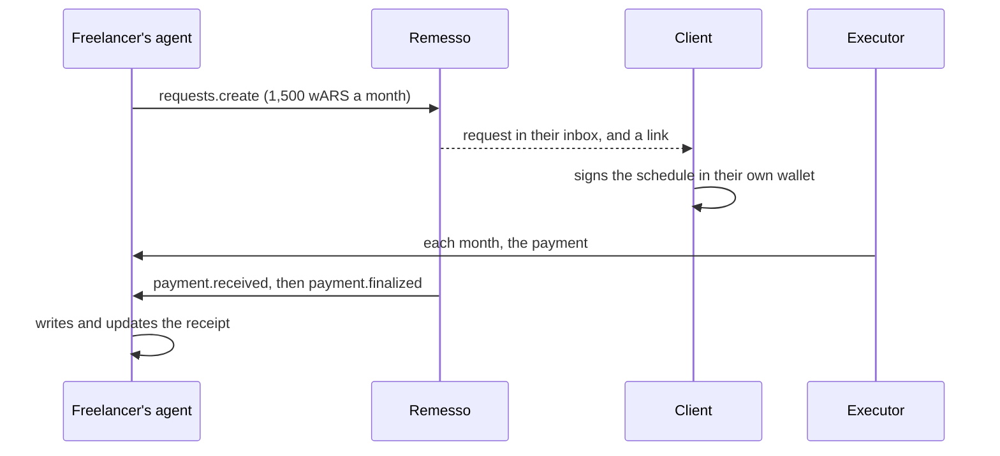

A freelancer in Buenos Aires bills a client every month, in Argentine pesos. Chasing each transfer takes time, and converting through dollars costs money at every step. With Remesso the freelancer asks once and the client signs once. After that, each month's payment arrives on its own, and the freelancer's agent writes a receipt for it.

## What you'll build

Three small programs, run by the freelancer:

- `request.ts` asks the client's wallet for a monthly amount and prints a link for the client.
- `receiver.ts` serves a webhook. It writes a receipt for each payment, then marks it final once Celo finalizes the block.
- `status.ts` shows where the request stands and lists its payments.



## Prerequisites

- The setup from [Installation](../installation.md), and a key for the freelancer. Receiving needs no gas and no balance.
- The client's wallet address. The client needs wARS for each payment plus Remesso's 0.25% fee, and about 0.05 CELO of gas to sign the schedule once.
- A public HTTPS address that reaches port 8787 on your machine. For a test, `cloudflared tunnel --url http://localhost:8787` prints one with no account.

wARS is Ripio's Argentine peso stablecoin. MiniPay doesn't show it, so the freelancer needs a wallet that does. Ripio's ramp turns it into pesos in a bank account, from the freelancer's own wallet: `https://ramp.ripio.com/off-ramp?country=AR&chain=42220&token=WARS`.

```bash
export FREELANCER_KEY=0x… CLIENT=0x… PUBLIC_URL=https://….trycloudflare.com
```

## Step 1: Ask the client

The amount you ask for is what you receive. The client's form adds Remesso's fee on top. The executor sends 1,500 to 1,500,000 wARS per payment, so ask for at least the minimum.

```ts title="request.ts"
import { writeFile } from "node:fs/promises";
import { createRemesso, formatAmount, runLimits, token, toUnits } from "remesso-sdk";
import { privateKeyToAccount } from "viem/accounts";

const freelancer = createRemesso({
  account: privateKeyToAccount(process.env.FREELANCER_KEY as `0x${string}`),
});

const amount = process.env.AMOUNT ?? "1500"; // wARS a month: what you receive
const wars = token("wARS");
const { min } = runLimits(wars);
if (toUnits(amount, wars) < min) throw new Error(`ask for at least ${formatAmount(min, wars)} a month`);

const req = await freelancer.requests.create({
  payer: process.env.CLIENT!,
  amount,
  token: "wARS",
  every: "month",
  runs: 12,
  from: "Your name",
  note: "Monthly retainer",
});

await writeFile("request.json", JSON.stringify({ id: req.id, reference: req.reference }));
console.log("Send your client this link:", req.link);
```

The request appears in the client's Remesso inbox, and the link opens their form with every field filled in. The link carries the request id, so the schedule they sign is reported against your request.

Nothing is authorised yet. A request can't move money: the client reviews the form and signs in their own wallet.

## Step 2: The client signs

The client answers in one of two ways:

- They open the link in their wallet's browser and sign in the Remesso app.
- Their own code answers with the request's terms, adding the fee so you receive the full amount:

```ts
await payer.schedules.create({ request: requestId }); // the request's terms, the fee on top
```

Either way, the result is a schedule on-chain. From then on nobody can change the amount, the recipient or the cadence, not even the client. The client can pause it or cancel it, and nothing else.

## Step 3: Hear each payment and write a receipt

`receiver.ts` checks that each payment comes from the schedule answering your request, then writes one receipt per payment. When the payment becomes final, the same receipt is rewritten as final. If a reorg undoes a payment, the receipt says it was void.

```ts title="receiver.ts"
import { mkdir, readFile, writeFile } from "node:fs/promises";
import { createServer } from "node:http";
import { createRemesso, formatAmount, RemessoError, webhookHandler, type WebhookMessage } from "remesso-sdk";
import { toNodeListener } from "remesso-sdk/node";
import { privateKeyToAccount } from "viem/accounts";

const freelancer = createRemesso({
  account: privateKeyToAccount(process.env.FREELANCER_KEY as `0x${string}`),
});
const url = process.env.PUBLIC_URL!;
const saved = JSON.parse(await readFile("request.json", "utf8")) as { id: string; reference: string };

let secret: string | undefined;
const seen = new Set<string>(); // webhook-ids already handled: keep these on disk in production

async function onPayment(m: WebhookMessage) {
  if (seen.has(m.id) || !m.data.schedule) return;
  const r = await freelancer.requests.get(saved.id);
  // The answer may not be recorded yet. Throwing makes Remesso retry the delivery.
  if (!r.payment?.schedule) throw new Error(`request ${saved.id} isn't answered yet`);
  if (r.payment.schedule.id !== m.data.schedule) return; // another payment to this address
  await writeReceipt(m);
  seen.add(m.id);
}

/// One receipt per payment, rewritten when it becomes final or is undone.
async function writeReceipt(m: WebhookMessage) {
  const d = m.data;
  const state = m.type === "payment.removed"
    ? "Void: the block holding this payment was replaced. Nothing was received."
    : d.final
    ? "Final."
    : "Received. Not final yet: Celo finalizes in about half an hour.";
  await mkdir("receipts", { recursive: true });
  await writeFile(`receipts/${saved.reference}-${d.runNumber}.md`, [
    `# Receipt ${saved.reference.slice(0, 8)}-${d.runNumber}`,
    `Received: ${formatAmount(d.amount, d.token)}`,
    `From: ${d.from}`,
    `Date: ${d.blockTime}`,
    `Transaction: https://celoscan.io/tx/${d.txHash}`,
    "",
    state,
  ].join("\n"));
  console.log(`${m.type}: payment ${d.runNumber}, ${formatAmount(d.amount, d.token)}`);
}

const handler = webhookHandler({ recipient: freelancer.address, secret: () => secret, onPayment });
const server = createServer(toNodeListener(handler));
await new Promise<void>((done) => server.listen(8787, done));

try {
  secret = (await freelancer.webhooks.subscribe({ url })).secret;
} catch (e) {
  // Subscribed before, and the secret is lost: rotate to a new one.
  if (!(e instanceof RemessoError && e.code === "conflict")) throw e;
  secret = (await freelancer.webhooks.rotate({ url })).secret;
}
console.log(`listening for payments on request ${saved.id} at ${url}`);
```

A few details matter here:

- **The secret arrives after the server starts.** Remesso first posts a challenge to your URL, and the handler answers it only for your address. `subscribe` returns the signing secret once that has worked, so the handler reads `secret` on each delivery. Store it with mode 0600 if the receiver must survive a restart.
- **Retries reuse the `webhook-id`.** A failed delivery is retried with the same id for 24 hours, so dedupe on `m.id`.
- **Throwing asks for a retry.** If `onPayment` throws, the handler answers 500 and Remesso delivers the message again later.

## Step 4: Check where it stands

Reading a request needs no key:

```ts title="status.ts"
import { readFile } from "node:fs/promises";
import { createRemesso, formatAmount } from "remesso-sdk";

const { id } = JSON.parse(await readFile("request.json", "utf8")) as { id: string };
const r = await createRemesso().requests.get(id);

console.log(`request ${r.id}: ${r.status}`);
if (r.payment) console.log(`payment: ${r.payment.state}${r.payment.reason ? ` (${r.payment.reason})` : ""}`);
for (const tx of r.payment?.txs ?? []) {
  console.log(`${tx.blockTime}  ${formatAmount(tx.amount, "wARS")}  ${tx.final ? "final" : "not final yet"}  https://celoscan.io/tx/${tx.txHash}`);
}
```

Accepted isn't the same as paid. A request reads `accepted` once a schedule answers it, and its payment reads `paid` only once a payment has a transaction.

## Test it safely

:::warning Real money
There is no testnet. These programs move real wARS on Celo mainnet. Use keys that hold only what you're willing to lose.
:::

1. Use a second wallet you control as the client. Give it about 1,510 wARS and a little CELO.
2. Ask for `AMOUNT=1500` with `runs: 1`, the smallest payment the executor sends.
3. Start `receiver.ts`, then sign the schedule from the client wallet.
4. If the client signs in the Remesso app, the first payment goes out within a minute or two. A schedule created from code is found by Remesso within about five minutes, and then paid. `payment.received` arrives soon after, and `payment.finalized` follows 25 to 30 minutes later.

## Where to go next

- [Payment requests](../guides/payment-requests.md): request states, declines and pay links.
- [Webhooks](../guides/webhooks.md): subscriptions, secret rotation and replays.
- [Payment events](../guides/payment-events.md): the same payments by polling, if you can't run a public endpoint.
- The complete agent, with the request saved and its deliveries remembered across restarts: [examples/freelancer-agent.ts](https://bitbucket.org/crackedstudios/remesso/src/main/examples/freelancer-agent.ts).
