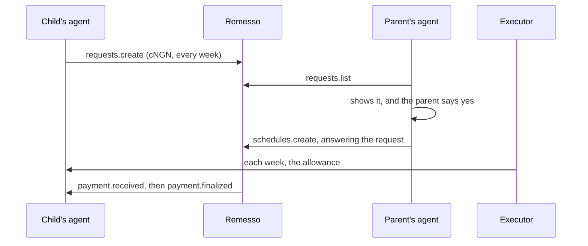

# A weekly allowance, approved by an agent

> A child's agent asks a parent for cNGN every week; the parent's agent shows the request and signs a weekly schedule after a yes.

Source: https://docs.remesso.xyz/docs/use-cases/family-allowance

A student in Lagos gets a weekly allowance from a parent, in naira. With Remesso, two agents handle it. The child's agent sends one payment request. The parent's agent shows it, asks the parent, and signs a weekly schedule on a yes. From then on, the allowance arrives every week, and the child's agent says so, with a link to cash it out to the child's own bank account.

## What you'll build

- `child.ts` asks the parent's wallet for a weekly amount of cNGN once, then listens for each payment by webhook.
- `parent.ts` lists the requests waiting for the parent's wallet, explains what signing would cost, and signs or declines.



## Prerequisites

- The setup from [Installation](../installation.md), on both sides.
- **The child:** a key, and a wallet that shows cNGN. MiniPay doesn't. Receiving needs no gas and no balance. The child also needs a public HTTPS address that reaches port 8788: `cloudflared tunnel --url http://localhost:8788` prints one for a test.
- **The parent:** a key holding cNGN for each payment plus Remesso's 0.25% fee, and about 0.05 CELO to sign once. Textile swaps USDT into cNGN on Celo: `https://app.textilecredit.com/s/swap?sell=USDT&buy=cNGN&chainId=42220`.

cNGN is the Nigerian naira stablecoin, with 6 decimals. Remesso's executor sends 1,300 to 1,300,000 cNGN per payment.

## Step 1: The child asks, and listens

The child's agent asks once and saves the request, so a restart doesn't ask again. Then it serves the webhook. A payment counts only if it comes from the schedule that answers this request.

```ts title="child.ts"
import { readFile, writeFile } from "node:fs/promises";
import { createServer } from "node:http";
import { createRemesso, formatAmount, RemessoError, webhookHandler, type WebhookMessage } from "remesso-sdk";
import { toNodeListener } from "remesso-sdk/node";
import { privateKeyToAccount } from "viem/accounts";

const TEXTILE_WITHDRAW = "https://app.textilecredit.com/s/sell?chainId=42220";
const child = createRemesso({
  account: privateKeyToAccount(process.env.CHILD_KEY as `0x${string}`),
});
const url = process.env.PUBLIC_URL!;

// Ask once. A restart reuses the saved request.
let saved = await readFile("allowance.json", "utf8").then((t) => JSON.parse(t) as { id: string }).catch(() => null);
if (!saved) {
  const req = await child.requests.create({
    payer: process.env.PARENT!,
    amount: process.env.AMOUNT ?? "1300", // cNGN a week: what you receive
    token: "cNGN",
    every: "week",
    runs: 12,
    from: "Your child",
    note: "Weekly allowance",
  });
  saved = { id: req.id };
  await writeFile("allowance.json", JSON.stringify(saved));
  console.log(`asked. If your parent prefers the Remesso app, this link opens the request: ${req.link}`);
}
const requestId = saved.id;

let secret: string | undefined;
const seen = new Set<string>();

async function onPayment(m: WebhookMessage) {
  if (seen.has(m.id) || !m.data.schedule) return;
  const r = await child.requests.get(requestId);
  if (!r.payment?.schedule) throw new Error("the allowance isn't answered yet"); // Remesso retries
  if (r.payment.schedule.id !== m.data.schedule) return; // some other payment to this wallet
  seen.add(m.id);
  const amount = formatAmount(m.data.amount, m.data.token);
  if (m.type === "payment.received") {
    console.log(`Allowance received: ${amount}, week ${m.data.runNumber}.`);
    console.log(`Cash it out to your own bank account on Textile ("Withdraw NGN"): ${TEXTILE_WITHDRAW}`);
  } else if (m.type === "payment.finalized") {
    console.log(`Week ${m.data.runNumber}: final.`);
  } else {
    console.log(`Week ${m.data.runNumber}'s payment was undone by a reorg. Nothing arrived: don't withdraw it.`);
  }
}

const server = createServer(toNodeListener(webhookHandler({ recipient: child.address, secret: () => secret, onPayment })));
await new Promise<void>((done) => server.listen(8788, done));
try {
  secret = (await child.webhooks.subscribe({ url })).secret;
} catch (e) {
  if (!(e instanceof RemessoError && e.code === "conflict")) throw e;
  secret = (await child.webhooks.rotate({ url })).secret; // subscribed before, and the secret is lost
}
console.log(`listening for the allowance at ${url}`);
```

Cashing out is Textile's "Withdraw NGN": the child withdraws from their own wallet to a bank account in their own name. Remesso pays out no naira itself.

## Step 2: The parent's agent asks, then signs

`requests.list()` returns the live requests sent to the parent's wallet: those still pending and under 30 days old. Before signing, the agent shows what the schedule will take. The child receives the amount asked, and the parent sends that plus the fee.

```ts title="parent.ts"
import { createInterface } from "node:readline/promises";
import { createRemesso, FEE_BPS, formatAmount, grossFor, token, toUnits } from "remesso-sdk";
import { privateKeyToAccount } from "viem/accounts";

const parent = createRemesso({
  account: privateKeyToAccount(process.env.PARENT_KEY as `0x${string}`),
});
const cngn = token("cNGN");

const [r] = (await parent.requests.list()).filter((x) => x.token === "cNGN" && x.amount && x.runs);
if (!r) {
  console.log("no cNGN requests are waiting");
  process.exit(0);
}

const each = grossFor(toUnits(r.amount!, cngn), FEE_BPS);
console.log(`${r.from ?? "Someone"} asks for ${r.amount} cNGN a week, ${r.runs} times: "${r.note ?? ""}"`);
console.log(`You'd send ${formatAmount(each, cngn)} a week, at most ${formatAmount(each * BigInt(r.runs!), cngn)} in all.`);

const ask = createInterface({ input: process.stdin, output: process.stdout });
const answer = (await ask.question("Sign it? [y/N] ")).trim().toLowerCase();
ask.close();

if (answer === "y") {
  const s = await parent.schedules.create({ request: r.id }); // the request's terms, the fee on top
  console.log(`schedule #${s.id} is live: https://celoscan.io/tx/${s.hash}`);
} else {
  await parent.requests.decline(r.id); // signed by this wallet: the child sees it declined
  console.log("declined");
}
```

Signing answers the request with its own terms. The SDK refuses a request addressed to a different wallet, or one that's no longer pending.

A decline is signed by the parent's wallet, so it holds for everyone: the child's `requests.get` then reads `declined`.

The schedule can't change once it's signed. The parent can pause it, resume it, or cancel it from the same client: `schedules.setActive(id, false)` and `schedules.cancel(id)`.

## Test it safely

1. Run `child.ts` with `AMOUNT=1300`, the smallest payment the executor sends. For a quick test, change `runs` to 1.
2. Give the parent wallet about 1,304 cNGN and a little CELO, then run `parent.ts` and answer `y`.
3. Remesso finds the schedule within about five minutes and sends the first payment. The child's terminal prints it, with the cash-out link, and marks it final about half an hour later.

## Where to go next

- [Payment requests](../guides/payment-requests.md): listing, answering and declining requests.
- [Webhooks](../guides/webhooks.md): the handler, the challenge and retries.
- [Give an AI agent a budget](./ai-agent-budget.md): an agent that pays from a policy instead of signing schedules.
- The complete pair of agents: [examples/family-allowance-agent.ts](https://bitbucket.org/crackedstudios/remesso/src/main/examples/family-allowance-agent.ts).
